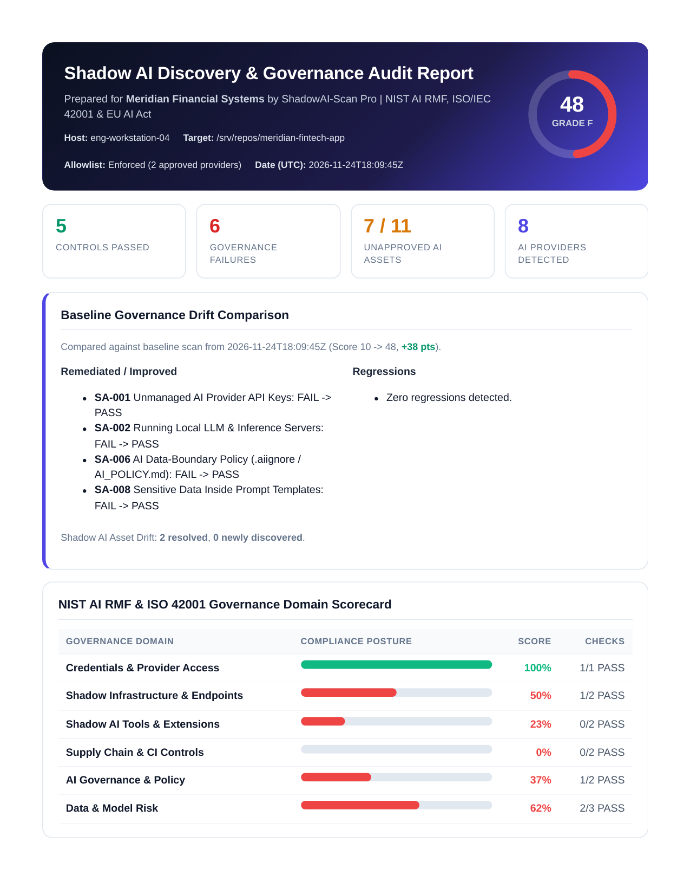

# ShadowAI-Scan

**Zero-dependency workstation and repository Shadow AI discovery and governance auditor mapped to NIST AI RMF, ISO/IEC 42001, and the EU AI Act.**

Engineering teams adopt new LLM SDKs, personal API keys, local inference servers, AI browser sidebars, and third-party AI GitHub Actions faster than IT or GRC teams can inventory them. Shadow AI quietly leaks source code, internal IPs, database connection strings, and customer PII outside approved Data Processing Agreements.

**ShadowAI-Scan** audits any developer workstation or Git repository in under 1 second using pure Python 3.10+ stdlib (zero external dependencies, 100% read-only, secrets always masked, zero browser history or cookie reads).

## 10-Second Quickstart

```bash
git clone https://github.com/rasetsukyo/shadowai-scan.git
cd shadowai-scan

# Full workstation + repository Shadow AI audit
python3 -m shadowai_scan scan --path .

# CI/CD repo-only audit (skips workstation ports, IDE/CLI configs & browser manifests)
python3 -m shadowai_scan scan --path . --repo-only --redact --fail-under 80

# Enforce a corporate approved-AI allowlist and export Markdown + JSON
python3 -m shadowai_scan scan \
  --path . \
  --allowlist ./approved-ai.json \
  --formats terminal,md,json \
  --out-dir ./audit
```

## What ShadowAI-Scan Audits (12 Governance Controls)

| ID | NIST AI RMF | ISO 42001 | Severity | Control |
| :--- | :--- | :--- | :--- | :--- |
| `SA-001` | NIST MAP 1.1 | A.6.2 | CRITICAL | Unmanaged AI provider API keys across 13 providers in env, dotfiles, `.env`, and repo files (always masked) |
| `SA-002` | NIST MAP 2.2 | A.6.2 | HIGH | Running local LLM and inference servers (Ollama `11434`, LM Studio `1234`, vLLM `8000`, llama.cpp `8080`, TextGen WebUI `7860`, ComfyUI `8188`, OpenWebUI `3000`; skipped in `--repo-only`) |
| `SA-003` | NIST MAP 1.5 | A.6.1 | MEDIUM | Installed AI IDE extensions and CLI coding agents (Cursor, Windsurf, Cline, Continue, Copilot, Claude Code, Codex, Aider, Gemini CLI; skipped in `--repo-only`) |
| `SA-004` | NIST MAP 2.3 | A.6.2 | HIGH | Unapproved AI SDK and LLM client dependencies in `requirements.txt`, `pyproject.toml`, `package.json`, `Cargo.toml`, and `go.mod` |
| `SA-005` | NIST MAP 3.1 | A.7.3 | HIGH | Hardcoded external LLM API endpoints (`api.openai.com`, `api.anthropic.com`, `api.deepseek.com`, `openrouter.ai`, `api.groq.com`, `generativelanguage.googleapis.com`) in source code |
| `SA-006` | NIST GOVERN 1.2 | A.2.2 | MEDIUM | Missing AI data-boundary policy (`.aiignore`, `.cursorignore`, `.copilotignore`, or `AI_POLICY.md`) |
| `SA-007` | NIST MEASURE 2.6 | A.7.4 | HIGH | Unredacted AI chat transcripts, prompt dumps, or fine-tuning `.jsonl` datasets committed to workspaces |
| `SA-008` | NIST MEASURE 2.10 | A.7.4 | CRITICAL | Sensitive data patterns (internal RFC1918 IPs, DB URIs, PII, credentials) inside prompt templates and system prompts |
| `SA-009` | NIST MEASURE 2.5 | A.6.2 | HIGH | Local model weight sprawl and unsafe pickle deserialization risks (`.pkl`, `.pt`, `.pth`, `pytorch_model.bin`, `.gguf`, `.safetensors`) |
| `SA-010` | NIST MAP 1.5 | A.6.1 | MEDIUM | AI SaaS browser extension static `manifest.json` metadata audit (never reads cookies, history, or login DBs; skipped in `--repo-only`) |
| `SA-011` | NIST MANAGE 2.4 | A.6.2 | HIGH | Unpinned or third-party AI GitHub Actions and CI workflows |
| `SA-012` | NIST GOVERN 1.4 | A.2.3 | MEDIUM | Shadow AI governance allowlist verification (`--allowlist approved-ai.json`) separating sanctioned AI from unapproved Shadow AI |

## Need White-Label PDF/DOCX Reports, CSV Asset Inventory, Drift Diff & Policy Pack?

The 12-check core scanner in this repository is free and MIT-licensed forever.

If you run AI governance audits for leadership, GRC committees, or consulting clients, grab **[ShadowAI-Scan Pro ($39 one-time, zero subscriptions)](https://rasetsukyo.gumroad.com/l/shadowaiscan)**:
- **White-Label Executive PDF & Editable Word (.docx) Governance Reports** mapped to NIST AI RMF, ISO/IEC 42001, and the EU AI Act (`--org`, `--auditor`, `--logo`, `--accent "#HEX"`)
- **CSV Shadow AI Asset Inventory (`shadowai-inventory.csv`)** ready for Excel, GRC trackers, and SIEM ingestion
- **Governance Drift Comparison (`--diff baseline.json`)** proving Shadow AI reduction across sprints and quarterly reviews
- **Corporate AI Governance Policy Pack:** `approved-ai-allowlist.json`, `AI_ACCEPTABLE_USE_POLICY.md`, enterprise `.aiignore`, and SHA-pinned GitHub Actions CI gate
- **Perpetual Commercial License** for unlimited internal and client audits



## Privacy & Read-Only Safety Guarantee

ShadowAI-Scan is strictly read-only. It never modifies files, never phones home, never reads browser cookies, passwords, history, or SQLite databases (only static `manifest.json` metadata), and always masks detected secret literals (`sk-proj-****...****`) before printing or exporting reports.
